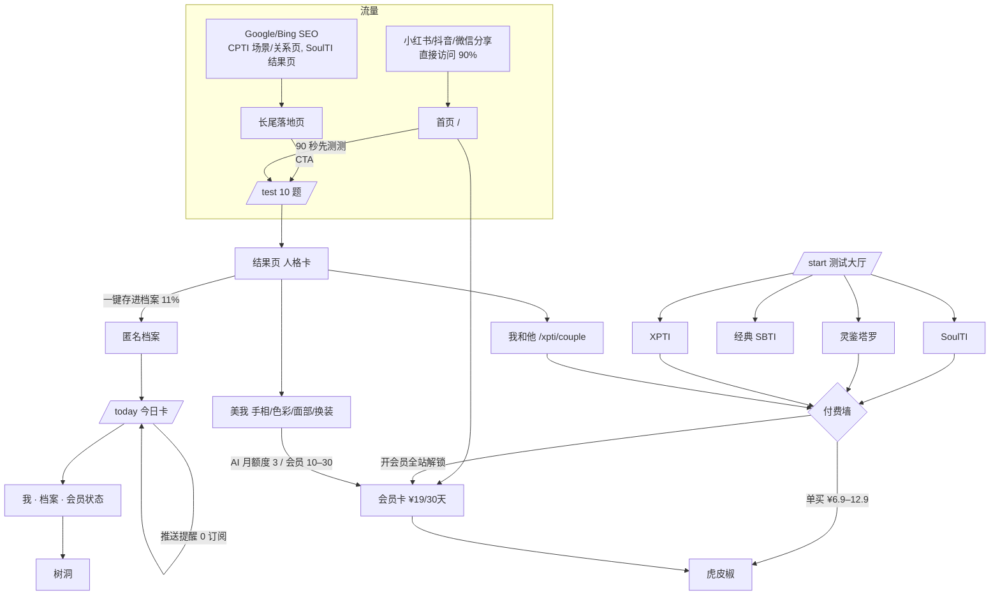

# WTFTI 核心业务地图（2026-10-21）

> 定位：**「90 秒测出你是谁，然后每天都更懂你一点」**。面向女性用户。全站会员 ¥19/30 天，不自动续费。
> 数据口径：prod `product_events`（列 `ts`），时间窗为近 30 天，统计截至 2026-10-21 03:40（北京时间）；排除 `ua='bot'`，按 `device_id` 去重。订单数据为 prod `mysti_orders` / `mirror_payment_orders` 全量。全程只读。
> 注意：`ua` 只存了浏览器大类（chrome/safari/wechat…），区分不出小红书、抖音的内置浏览器；`referrer` 约 90% 为空，所以「直接访问」实际上包含站外 App 分享的流量。

## 1. 流量来源（近 30 天，2,064 台设备）
| 维度 | 数据 |
|---|---|
| 首次来源 | 直接访问（含 App 内分享）1,856（90%）· 站内跳转 96 · Google 71 · Bing 24 · sbtinb.com 8 · ChatGPT/豆包 各 1–2 |
| 浏览器 | Chrome 1,601 · Safari 226 · 未知 116 · 微信 94 · Edge 24 |
| 首个落地页（Top） | /start/ 401 · / 228 · /soulti/result/* 203 · /cpti/result/* 197 · /types/ 115 · /cpti/scenarios/lover/ 111 · /mysti/subscribe/ 70 · /mysti/result/* 64 · /test/ 50 · /xpti/couple/ 34 |
| 周活设备 | 8 月初峰值 1,364/周 → 9–10 月 286–757/周（10/12 当周有一次小高峰） |

结论：
- 自然搜索流量主要落在 CPTI 的场景页、关系页（SEO 长尾）和 SoulTI 结果页（分享回流）。新首页（/）和 90 秒首测（/test/）作为入口的占比还很小。

## 2. 测试入口
| 入口 | 位置 | 30 天设备 |
|---|---|---|
| 90 秒首测 FirstLook（主线） | 首页 CTA → /test/ | 进入 77 · 完成 99（含 home 侧完成事件）· 点进深度测试 18 |
| 测试大厅 /start/ | 底部 Tab「测试」 | 落地 437（含旧页面 308 跳转过来的流量） |
| SoulTI 自然人格 | /soulti/test/ | 完成 212（存量里最大的测试） |
| CPTI 关系 | 主要是 SEO 页；单人测试已 308 到 /xpti/couple/ | 结果页 242 · 场景页 213 |
| 灵鉴 Mysti 塔罗 | /mysti/ | 模块 386 · 付费墙曝光 205 |
| 我和他 XPTI couple | /xpti/couple/ | 邀请打开 11 · 创建 6 · 完成 4 |
| 经典 SBTI 46 题 | /test/classic/ | 开始 9 · 完成 8 |

## 3. 主线漏斗（近 30 天，设备数）
```
首页浏览 244 → 首页 CTA 点击 32
onboarding_start 440 → 首测完成 99 → 一键建档 archive_created 11 → 注册完成 10
/today 落地 53（module_landing_view 70）→ 开启推送 1（push_subscriptions 当前 0 条）
会员页浏览 2 → 会员结算发起 0
```
- 首测完成到建档的转化约 11%，是主线上最大的流失点。
- 留存很弱：30 天内只有 27 台设备（1.3%）在 ≥2 个不同日期活跃；8–38 天前首访的 1,411 台设备中，D1 回访 7 台、7 日内回访 8 台。
- 「每天都更懂你一点」的日更钩子（今日卡 + 推送）目前几乎没有生效。

## 4. 付费点与真实订单（prod 全量）
| 付费点 | 价格 | paid | pending | failed | 备注 |
|---|---|---|---|---|---|
| 会员 monthly-pass（全站会员） | ¥19/30 天 | 1（5/07） | 7 | 13 | her_profiles 当前有效会员 0；mysti_subscriptions 有效 0 |
| 我和他 双人报告 xpti-couple-report | ¥12.9 | 3 | 15 | 5 | 会员免费 |
| 我和他 AA xpti-couple-half | ¥6.9 | 2 | 12 | 0 | |
| SoulTI 深夜长信 soulti-deep-mirror | ¥9.9 | 2 | 2 | 0 | 最近一笔 9/11 |
| WTFTI 深度主神 wtfti-deep-pantheon | ¥6.9 | 1 | 2 | 0 | |
| 塔罗灵魂信 soul-letter | ¥9.9 | 0 | 0 | 3 | |
| WTFCard 典藏 wtfcard-collector | ¥3.9 | 0 | 7 | 0 | |
| 分享卡 Plus share-plus | ¥4.9 | 0 | 1 | 0 | |
| 礼品卡 gift-card | ¥39.9 | 0 | 2 | 0 | 不纳入会员 |
| 美我 换装包 mirror_payment_orders | ¥10 / ¥19.9 / ¥30 | 4 | — | — | 金额本次未统计 |
| creator 订单 | — | 0 | — | — | |

- mysti_orders 历史已支付合计约 **¥98.2**（9 笔）。近 30 天 mysti_orders **0 笔**（含 pending）。
- pending 订单很多（≈48 笔），意味着用户到了虎皮椒页面但没有付款。原因可能是收银台体验、价格，或微信/支付宝跳转的问题。
- 支付每天 02:00–06:00（北京时间）暂停收款。

## 5. 留存机制（现状）
| 机制 | 状态 |
|---|---|
| 今日卡 /today（需建档） | 30 天落地 53 台设备；匿名用户先看到登录墙 |
| 每日推送 | push_subscriptions 0 条；iOS 必须先「添加到主屏幕」；页面直接显示「通知被关掉了」，没有引导 |
| 档案「我」页 + 会员卡 | 已上线，注册/建档 10–11 人 |
| 塔罗每日一牌 /mysti/daily/ | 26 台设备 |
| 树洞（漂流瓶） | drift_bottles 共 2 条，回复 0 |
| 我和他 邀请回流 | 邀请打开 11，完成 4 |
| 邮件 letters（cron） | letter_sealed 1 |

## 6. 不在主线上的功能 / 建议砍掉的候选
| 功能 | 30 天数据 | 建议 |
|---|---|---|
| CPTI 场景页 / 关系页 / 图鉴 | 流量较大（SEO），但不转化 | 保留作为 SEO 落地页，把 CTA 改成导向 90 秒首测 |
| museum（图鉴馆 / 月度回顾） | 212 台设备，0 付费 | 并入「我」的档案，或下线 |
| /types/ 类型图鉴 | 125（现已 308 跳走） | 已下线；SEO 外链落地即跳转，留意 Search Console |
| /card/ WTFCard、分享卡 Plus、典藏 | 68 台设备，0 paid（/card/ 现已 308） | 付费 SKU 一并下线 |
| 经典 SBTI 46 题 | 9 | 收进测试大厅的「更多」 |
| 礼品卡 / 闺蜜包 / creator | 0 paid | 下线入口 |
| 塔罗决策卡、Sigil、gacha | 决策入口 18 · sigil 11 · gacha 7 | 并入会员权益，不单独推 |
| 树洞 | 2 条 | 要么强化（首测后引导写第一句），要么降级 |
| 美我 AI（手相/色彩/面部/换装） | 落地 20，换装 paid 4 | 与「变好看」定位一致，保留；需要补埋点（mirror 模块目前 0 事件） |
| XPTI 测试页上的旧测试链接（bird/fanrenti/flower/hogti/delta/feng/kings/zhenhuan） | 都会 308 到 /start/ | 删掉这些链接 |

## 7. 业务流程图


## 8. 结论（与定位对齐）
1. **先把主线做通**：首测完成 → 建档（11%）→ 次日回来（D1 约 0.5%），这条链是第一优先级。
2. **日更钩子目前不成立**：推送 0 订阅，今日卡被登录墙挡住。应改成匿名就能看今日卡，推送在 iOS 上走「添加到主屏幕」引导。
3. **付费可以收敛到会员 + 我和他单买**，其余 SKU 下线入口，减少认知负担。
4. **SEO 存量（CPTI/SoulTI）当作获客池**，统一导向 90 秒首测。
